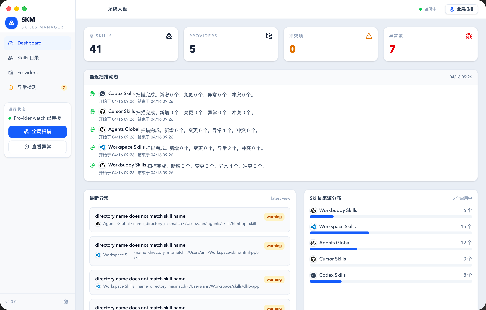
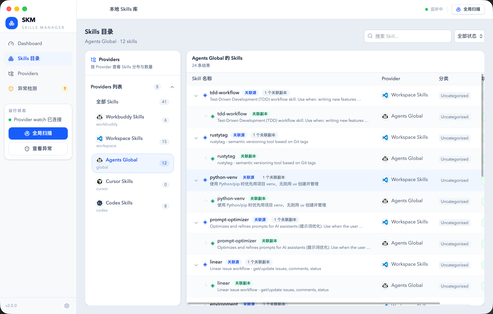

# SKM

[English](README.md)

**SKM 是主要为 Agent 准备的本地 Skills 管理与调用工具。** 给 Agent 一个 SKM 入口，让它按任务查找技能、读取需要的内容、执行已声明的命令。技能集中维护，多个 Agent 按需使用。

[](https://github.com/sichang824/skm/actions/workflows/release.yml)
[](https://github.com/sichang824/skm/releases/latest)

**欢迎哔哩哔哩的小伙伴们来使用 SKM！** 如果你也有一批为 Agent 准备的 Skills，希望下面这套用法能帮你减少重复安装和无关上下文。

## 为什么做 SKM

我电脑里有 280 多个 Skills，都是为 Agent 服务的。我也给 SKM 做了 GUI，但自己几乎不打开它。日常使用时，主要是 Agent 在查找、读取和调用技能。

我的做法是：不在每个 Agent 中逐一安装这些业务技能，交给 SKM 统一管理；Agent 只需要知道如何使用 SKM。技能库里有多少能力，与一次任务需要读多少内容，可以分开考虑。

**技能可以很多，进入当前上下文的内容应该尽量少、尽量相关。**

这不是“零指令运行”：Agent 仍然需要必要的运行约束、工具权限和一个 SKM 使用入口。重点是让低频、任务相关的业务技能按需出现。完整的设计思路见 [为什么我有 280 多个 Skills，却几乎不打开 GUI](docs/agent-first.md)。

## 让 Agent 使用 SKM

先安装 CLI 并确保 Agent 能调用 `skm`（见 [CLI](#cli)）。将技能源目录注册为 Provider 并扫描后，Agent 就能查询。CLI 可独立工作，不要求打开 GUI 或启动 Web 服务。

```bash
# 一次性注册你的技能源目录；路径替换为实际位置。
skm providers add --name "My Skills" --type workspace --root /path/to/skills
skm scan all

# 日常任务：先用具体名称、关键词或标签缩小范围。
skm skills -q meeting
skm skills --tag meeting

# 将下面的占位符替换为查询结果中的 ZID 和声明的命令名。
skm skills get <技能ZID>
skm skills get <技能ZID> references/guide.md
skm skills get <技能ZID> --commands
skm skills exec <技能ZID> <命令名> --dry-run
skm skills exec <技能ZID> <命令名>
```

上面的 `meeting` 和文件路径只是用法示例，是否命中取决于你的技能库。当前搜索匹配名称、目录名、标签、简介等字段中的关键词，不是语义搜索。并非所有技能都包含可执行命令。

给 Agent 的最小接入说明可以是：

> 遇到需要专门知识或工具的任务，先用 `skm skills -q <具体关键词>` 查找技能。命中后用 `skm skills get <ZID>` 读取说明，按需读取其中引用的文件；有声明的命令时，先查看命令与参数，再通过 `skm skills exec` 调用。不要默认加载全库清单或全部技能正文。涉及确认要求时，先取得用户授权。

也可以将本仓库的 [SKILL.md](SKILL.md) 作为单个技能入口交给 Agent，详细用法随任务读取。能够调用本机命令、访问相应目录且具备所需权限的 Agent 可以复用这套入口；远程或沙箱中的 Agent 需要另外提供可访问的运行环境或接口。

## 已实现的关键设计

- **先搜索，再读取**：不必在每次会话里预置整个技能目录；命中后再读取技能说明与具体文件。
- **内容与 Agent 分开维护**：技能源由 SKM 索引，同一台机器上的多个 Agent 可以使用同一批技能；无需为每个 Agent 复制整套业务技能。
- **说明与执行连起来**：`SKILL.md` 解释怎么用，`package.json` 声明能调用哪些命令；`exec` 统一处理参数、输入校验、环境检查、超时与声明的确认要求。
- **调用可以追溯**：执行记录保留状态、退出码和内容哈希等信息；`--pin` 可在对应历史内容仍可用时重放指定版本。
- **人按需要介入**：GUI 用于检查目录、冲突和问题；日常能力取用可以直接由 Agent 完成，人负责目标、授权、关键判断与异常处理。

## 关于 token 与未来交互

减少 token 的关键是减少进入上下文的无关内容，而不是单纯少复制几份磁盘文件。SKM 将查找、读取和执行分开，让 Agent 只取当前任务需要的部分；查询返回、技能正文和执行结果本身仍会消耗 token，净收益需要按具体任务测量。

现有 [Agent Skills 实现指南](https://github.com/agentskills/agentskills/blob/main/docs/client-implementation/adding-skills-support.mdx) 已经支持按需加载技能正文。SKM 的使用方式进一步把“查找技能”也放到任务发生时，而不要求 Agent 预先持有完整目录。

我判断，未来会有更多信息和能力直接交给 Agent 消费，Agent 之间也会承担更多协作。人的精力可以更多放在目标、授权和关键决策上。SKM 当前提供的是本地技能检索、内容读取与执行能力；这种设计可以服务于未来的协作方式，但当前并未实现 A2A 协议或通用事件流平台。详见 [理念与边界](docs/agent-first.md)。

## 下载与安装

桌面版无需配置 Go、Node.js 或开发环境，直接到 **[Releases 下载最新版本](https://github.com/sichang824/skm/releases/latest)**。

| 系统 | 下载文件 | 安装方式 |
| --- | --- | --- |
| macOS（Apple Silicon / Intel） | `SKM-v版本号-macos-universal.zip` | 解压后将 `SKM.app` 拖到“应用程序” |
| Windows 10/11 x64 | `SKM-v版本号-windows-x64.zip` | 完整解压到固定目录，双击 `SKM.exe`；保留旁边的 `cli` 目录 |

如果选择 GUI，在 **Providers** 中添加技能目录并扫描，即可在 Skills 目录页浏览和管理；Agent 的日常接入优先使用上面的 CLI 流程。默认数据保存在用户目录的 `.skm` 文件夹中；升级时替换程序，保留数据目录即可。

目前发布包未使用开发者证书签名或 Apple 公证。macOS 若阻止打开，可在“系统设置 → 隐私与安全性”中确认来源后选择“仍要打开”；Windows 可能显示 SmartScreen 提示。Windows 需要 [Microsoft WebView2 Runtime](https://developer.microsoft.com/microsoft-edge/webview2/)，缺少时应用会提示运行官方安装引导器，安装过程需要网络。

浏览、扫描和管理技能不需要额外的命令行工具。Windows 上执行技能命令时，需要安装 [Git for Windows](https://git-scm.com/download/win)，并把包含 `sh.exe` 的 `Git\bin` 目录加入 PATH；技能脚本使用的 Node.js、Python 等工具也需自行安装。

遇到问题欢迎提交 [GitHub Issue](https://github.com/sichang824/skm/issues)，附上 SKM 版本、系统版本和复现步骤。如果觉得好用，欢迎点个 Star，也欢迎推荐给其他哔哩哔哩用户！

## 界面预览

### Dashboard



GUI 是可选的人工检查入口。Dashboard 集中展示 provider 数量、skills 总数、最新异常、扫描动态和来源分布。

### Skills Catalog



Skills 目录页支持按 provider 浏览技能，展开关联副本，并把筛选、检索和来源上下文放在同一页面里。

## 设计原则

技能源目录、索引和调用入口各司其职。默认按任务查询，内容逐步读取；GUI、CLI 和 REST API 共享后端能力。SKM 保留 attach、link 和同步功能供兼容场景使用，日常 Agent 接入优先采用源目录集中维护、按需读取与执行的方式。

有关执行声明、缓存、历史版本和记录的实现，见 [技能执行设计](docs/skill-manifest-exec.md)。`--isolate` 使用缓存工作副本，属于工作目录隔离，不是权限沙箱。

## Architecture

```text
skm/
├── backend/    # Shared services, scanner, REST API and cmd/skm CLI
├── frontend/   # Optional React + Vite inspection UI
├── build/      # Desktop build output
├── main.go     # Wails desktop entry
├── wails.json  # Wails config
├── SKILL.md    # Agent entry instructions
└── README.md
```

## Tech Stack

- Backend: Go 1.24, Gin, GORM, SQLite or PostgreSQL
- Frontend: React 19, TypeScript, Vite, Tailwind CSS v4, React Router v7, Vitest
- Desktop: Wails v2.12.0

## 开发环境

### Prerequisites

- Go 1.24+
- Node.js 22.12+
- pnpm 10+

### Run the full stack

```bash
make dev
```

默认地址：

- Backend: `http://localhost:8080`
- Frontend: `http://localhost:5173`

如需改端口：

```bash
BACKEND_PORT=18080 FRONTEND_PORT=4173 make dev
```

### 使用 seed 启动

```bash
make dev/seed
```

这个命令会重置本地 SQLite 数据库，启动前后端，并基于当前机器上常见的技能目录写入默认 Provider 记录。

### 分别启动各部分

Backend:

```bash
cd backend
cp .env.example .env
make run
```

Frontend:

```bash
cd frontend
make install
make dev
```

### 桌面版开发模式

```bash
make app-dev
```

### 构建 macOS app

```bash
make app-build
```

生成的 `.app` 会输出到 `build/bin/`。

如果桌面版在仓库目录之外启动，SQLite 默认会落到 `~/.skm/app.db`。需要时可以通过 `DB_DSN` 覆盖。

## Common Commands

```bash
make install       # 安装前端依赖并预加载 Go modules
make dev           # 同时启动后端和前端
make dev/seed      # 重置数据库并以 seeded providers 启动
make reset         # 删除本地 SQLite 数据库文件
make seed          # 一次性写入默认 providers 后退出
make test          # 运行前后端测试
make build         # 构建后端二进制和前端产物
make cli-build     # 构建 skm CLI 二进制
make cli-install   # 安装 skm CLI 到 ~/.local/bin
make app-dev       # 启动 Wails 桌面开发模式
make app-build     # 构建 macOS 桌面应用
```

## CLI

CLI 是 SKM 面向 Agent 的主要入口，和桌面版共用同一套数据库与后端服务能力。可以直接取用 Release 包中的 CLI（macOS：`SKM.app/Contents/Resources/skm`；Windows：`cli/skm.exe`），加入 PATH 后使用，无需打开桌面应用。

构建 CLI：

```bash
make cli-build
```

安装到 `~/.local/bin`：

```bash
make cli-install
```

示例命令：

```bash
skm version
skm dashboard
skm providers
skm providers add --name "Workspace Skills" --type workspace --root ~/Workspace/skills
skm providers update PROV0001 --priority 400 --description "main workspace provider"
skm providers delete PROV0001
skm skills --provider "Workspace Skills"
skm skills get SKIL0001
skm skills to --provider-path /path/to/provider --include README.md --include scripts/** --exclude plugins/**
skm skills link SKIL0001 --to PROV0002
skm skills move SKIL0001 --to PROV0003
skm skills sync SKIL0002
skm skills delete SKIL0002
skm issues --view latest
skm scan all
skm scan provider PROV0001
```

桌面版侧边栏的运行状态卡片现在也提供 `Install CLI` 按钮，会把随 app 打包的 CLI 安装到 `~/.local/bin/skm`。

## API Overview

公共接口：

```text
GET  /healthz
GET  /version
GET  /api/dashboard
```

Provider 和扫描接口：

```text
GET    /api/providers
POST   /api/providers
GET    /api/providers/:zid
PUT    /api/providers/:zid
DELETE /api/providers/:zid
POST   /api/providers/:zid/scan
POST   /api/scan
GET    /api/scan-jobs
GET    /api/scan-jobs/:zid
GET    /api/issues
GET    /api/issues?view=latest
GET    /api/conflicts
```

Skill 接口：

```text
GET  /api/skills
GET  /api/skills?grouped=true
GET  /api/skills/:zid
POST /api/skills/:zid/attach
GET  /api/skills/:zid/files
GET  /api/skills/:zid/file-content?path=SKILL.md
```

请求和响应示例见 `docs/frontend-api-contract.md`。

## Configuration

主要运行配置位于 `backend/.env`：

- `PORT`: 后端端口，默认 `8080`
- `DB_DRIVER`: `sqlite` 或 `postgres`
- `DB_DSN`: 数据库连接串，默认 `./data/app.db`
- `SEED`: 启动时写入默认 providers
- `SEED_ONLY`: 只 seed 后退出

通过 Wails 开发模式运行时，桌面宿主也会读取 `backend/.env`。

## Repository Guide

- Backend setup and API notes: `backend/README.md`
- Frontend setup and scripts: `frontend/README.md`
- Frontend API contract: `docs/frontend-api-contract.md`
- Product notes: `docs/PRD.md`

## 版本管理与自动发布

使用 **RustyTag** 管理语义化版本、生成更新日志和创建标签。Git 标签是版本号的唯一来源；CI 将标签写入应用和 CLI 的版本信息。仓库的 `.rustytag.json` 已配置 `v` 前缀。

```bash
# 先提交所有改动，再在 main 上创建版本。
rustytag show
rustytag patch        # 新功能用 minor，破坏性变更用 major
# 首次公开发布：rustytag patch --version v0.1.0

git push --follow-tags origin main
```

只有推送 RustyTag 创建的 `v*` 版本标签才会触发这条流水线：执行测试、编译 macOS 通用版与 Windows x64 版，全部成功后自动发布 Release，包含两个 ZIP 包与 `SHA256SUMS.txt`。普通分支提交（包括 main）、文档更新和 Pull Request 都不会触发。带预发布后缀的标签会标记为 Pre-release。发布使用 GitHub 自动提供的令牌，无需配置个人 Token。

详见 [发布维护说明](docs/releases.md)。

## Contributing

欢迎提交 issue 和 pull request。

- Bug report: 尽量附上复现步骤、预期行为、实际行为，以及相关日志或截图
- Feature proposal: 先描述用户问题，再描述提议的交互或 API 设计
- Pull request: 保持范围聚焦，行为有变化时同步更新文档，并写清验证方式

完整贡献说明见 `CONTRIBUTING.md`。

## Acknowledgements

SKM 站在很多优秀开源项目之上，这里特别感谢：

- Wails: 提供桌面宿主和前后端整合能力
- Gin and GORM: 提供 Go 侧 HTTP 服务与数据访问基础设施
- React and Vite: 提供现代前端应用与开发体验
- Tailwind CSS, Radix UI, and shadcn/ui: 提供界面构建基础
- Lucide, GSAP, Motion, and Zustand: 支撑图标、动画和交互状态管理

同时，这个项目也受到本地优先工具链和技能目录工作流的启发，包括围绕 `SKILL.md` 组织能力描述、用目录作为分发单元、以及把冲突检测和可视化管理做成一等能力。

## License

MIT. See `LICENSE`.
