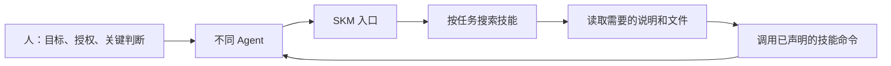

# 为什么我有 280 多个 Skills，却几乎不打开 GUI

## 从我的实际用法说起

我电脑里有 280 多个 Skills，都是为 Agent 服务的。我给 SKM 做了 GUI，但自己几乎不打开它。真正经常使用 SKM 的，是在任务中查找技能、读取说明、调用工具的 Agent。

我的做法是，不把这些业务技能逐个装进每个 Agent 的技能目录。它们交给 SKM 管理，Agent 只需要知道如何通过 SKM 找到和使用它们。必要的运行规则、权限，以及 SKM 这个入口，仍然需要提供给 Agent。

这件事最值得分享的地方，是让“我拥有多少能力”和“Agent 现在需要知道多少内容”分开。

一个任务只需要其中两三个技能，就先找到这两三个。等需要别的能力时，再继续查。技能库可以增长，每次任务不必因此背上越来越长的能力介绍。

## 我想改变的使用习惯

如果我们谈论 Skills 时，只讨论安装了多少个、目录怎么摆、管理界面好不好看，就容易忽略后面真正发生的事情：Agent 到底怎样找到能力？读了多少不相关的内容？能不能直接调用？调用失败后能不能知道原因？

我希望把注意力放到这些问题上：

- Agent 接到任务后，能否自己找到需要的技能？
- 找到之后，能否只读需要的说明和文件？
- 能执行的工作，能否直接交给声明好的命令完成？
- 换一个 Agent，能否继续使用同一批技能源？
- 人能否把精力放在目标、授权、关键判断和异常处理上？

GUI 可以帮助人检查系统，但日常工作也可以直接从 Agent 的工具调用完成。界面打开得少，并不影响这套用法成立。

## SKM 已经怎样实现这套思路

| 设计选择 | 已实现的机制 | 实际意义 |
| --- | --- | --- |
| 任务发生时再找技能 | `skills -q`、标签与来源过滤 | Agent 不必预先带着完整技能清单 |
| 命中后再逐步读取 | `get`、目录与单文件读取、下一步提示 | 阅读范围可以跟着任务缩小 |
| 技能源独立于 Agent 维护 | Provider 索引、源目录读取与执行 | 多个本地 Agent 复用源，不必各自维护整包副本 |
| 把可执行能力明确列出来 | `package.json` 声明命令，`exec` 统一调用 | Agent 有一致的调用入口，不必每次猜测怎么启动脚本 |
| 执行前检查必要条件 | 输入校验、环境检查、声明的确认要求、超时 | 失败能更早暴露，需要人授权的步骤有明确位置 |
| 保留执行依据 | 状态、退出码、内容哈希与执行记录 | 可以追查运行了什么；历史内容仍可用时可按哈希重放 |

这套机制既支持纯说明型技能，也支持带脚本的技能。纯说明型技能需要 Agent 读取和理解；带有可执行清单的技能，还可以通过 `exec` 调用。并非每个技能都必须有脚本。

当前搜索是对名称、目录名、标签、简介等字段进行关键词匹配，不能保证理解任意自然语言表达。描述是否清楚、查询是否具体，都会影响发现效果。

## token 到底省在哪里

少复制几份文件，主要减少的是磁盘副本和维护工作。只有少把无关内容送入模型上下文，才会减少相应的 token。

需要公平比较：[Agent Skills 的实现指南](https://github.com/agentskills/agentskills/blob/main/docs/client-implementation/adding-skills-support.mdx) 已经将目录信息、技能正文和附属资源分层加载。因此，不能假设其他方案一开始都会读完全部技能正文。

SKM 这套用法还把“发现技能”提前分开了：Agent 先知道一个查询入口，任务发生后再取得相关候选，不要求会话开始时就带上整个技能目录。

它主要减少三类不必要的阅读：每次都出现的无关技能描述、没有用到的技能正文，以及无须逐行阅读就能通过命令执行的脚本源码。必要的使用说明、输入要求和执行结果，仍然需要进入上下文。

这也有代价：查询本身要调用工具，查错了还要重试，返回过长的清单或日志同样会消耗上下文。对少量高频、几乎每次都用到的技能，保留简短的常驻说明可能更合适。SKM 的入口本身也应该保持精简，详细说明随任务获取。

目前这里表达的是设计上的节省机制，没有公布固定的节省比例。下一步值得用相同任务、相同模型、相同技能源做对比，同时记录：

- 完成一次任务实际使用的输入、输出 token，以及缓存输入和计费差异。
- 额外查询与重试次数、完成耗时。
- 是否找到正确技能、任务是否成功、是否需要人纠正。

比较时应使用已经支持按需加载的方案作为基线，保留完整调用过程。这样才能说明在哪些任务上省了、在哪些任务上收益有限。

## 我对未来交互方式的判断

我认为，未来会有越来越多的信息和能力先交给 Agent 消费，任务也会更多地在 Agent 之间交接。软件除了向人展示界面，还需要让 Agent 能发现能力、理解输入、发起调用并取得结果。

这并不要求所有信息都变成实时数据流。文件、文档、结构化数据、事件和结果引用，都可能是合适的载体。重点是 Agent 能否可靠地取用它们，而不是人为规定所有东西必须长成同一种形式。

我期待人的精力逐渐从重复操作转向目标、授权和关键决策，同时继续承担创造、纠错和责任。这是我的设计方向与未来判断，不是对所有软件场景的结论。

如果这里的 A2A 指一般意义上的 Agent 之间协作，这套能力取用方式可以成为协作的基础。如果指具体的 [Agent2Agent 协议](https://a2a-protocol.org/latest/specification/)，它解决的是独立 Agent 之间的通信和任务协作；SKM 当前提供本地技能检索、读取与执行，尚未实现该协议。一次技能调用也不必然是向另一个 Agent 委派任务。

## 接下来值得补齐什么

我更愿意用实际效果完善这套方式：先衡量检索是否准确、上下文是否更省、任务是否做成，再决定扩展哪些接口。

三个值得继续推进的方向是：入口更短、搜索结果更适合 Agent 筛选；命令返回更清楚的结果、产物位置和下一步，而非大量无关日志；不同 Agent 或远程环境接入时，有清楚的访问范围、身份与执行记录。它们是后续改进方向，不代表当前已经具备完整的远程协作能力。

当前本地接入需要 Agent 能调用 `skm`，并能访问技能目录和所需工具。执行以当前用户权限运行，`--isolate` 提供缓存工作副本，不是权限沙箱；声明确认要求，也不意味着 Agent 可以自行替用户批准。

[返回中文 README](../README.zh-CN.md)
